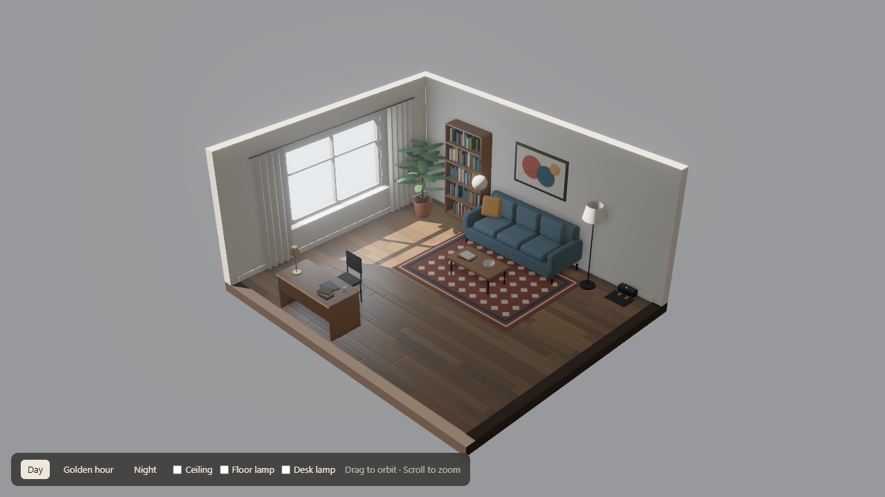

# kryt-room

A small, furnished 3D room with realistic lighting and a [Gymnasium](https://gymnasium.farama.org) API. Train your own agents in a fast Python simulation of the room, then watch them in the 3D view.



The repo contains the environment only. There is no bundled agent: you bring your own, whether that's reinforcement learning, a planner or an LLM.

## Install

Python 3.10 or newer.

```bash
git clone https://github.com/Sehastrajit-S/kryt-room.git
cd kryt-room
pip install -e .
```

## Quick start

```python
import gymnasium as gym
import roomworld

env = gym.make("RoomWorld/Navigate-v0")
observation, info = env.reset(seed=0)

done = False
while not done:
    action = env.action_space.sample()   # replace with your agent
    observation, reward, terminated, truncated, info = env.step(action)
    done = terminated or truncated
```

## The environment

The agent is a round body, 0.24 m in radius, on a 6 x 5 m floor with furniture and a charging dock (the named place `dock`). Each step is 0.1 seconds.

| Action | Effect |
|---|---|
| `0` idle | Nothing |
| `1` forward | Move 0.06 m, or stop and report a collision |
| `2` turn left | Rotate 0.25 radians |
| `3` turn right | Rotate 0.25 radians the other way |
| `4` interact | Press the nearest lamp switch within 0.45 m |

Observations are a flat vector, with every value in `[-1, 1]`:

| Values | Meaning |
|---|---|
| 4 | Position x and z, then sine and cosine of heading |
| 16 | Lidar: distance to the nearest wall or furniture, starting from the agent's heading |
| 3 | Lamps on or off, in the order ceiling, desk, floor |
| 1 | Daylight, from 0 (dark) to 1 (bright) |
| varies | Whatever the task adds |

`info["state"]` holds the world as readable values (position, heading, daylight, lamps), which is handy for agents that work from text.

## Dust

The floor gets dirty the way a lived-in room does, and it keeps changing during an episode. Dust isn't part of the base observation, so tasks choose how much of it an agent can sense. Each 25 cm square has a level from 0 to 1, built from:

| Source | Where it lands |
|---|---|
| Foot traffic | Along walking routes between the door, desk, table and window |
| Entrance | Just inside the door |
| Crumbs | Around the coffee table, on some days |
| Desk chair | In front of the desk chair, on most days |
| Plant soil | Next to the plant pot, on some days |
| Window sill | A strip below the window |
| Edges | Along walls and furniture |
| Rug | Holds on to more of whatever lands on it |

Each episode is a new day: how busy it was, which routes were used and where the clumps fall all vary. While the episode runs, dust keeps settling, and someone may walk through or something may spill. Seeds make all of this repeatable.

Tasks reach it through `world.dust`:

```python
from roomworld import RoomEnv

env = RoomEnv()
env.reset(seed=0)
dust = env.world.dust

removed = dust.clean(x=2.0, z=1.9, radius=0.22)          # lift dirt, returns how much
nearby = dust.sense(x=2.0, z=1.9, heading=0.0)           # dirt in 8 directions within 1.5 m
remaining = dust.total()
```

The sources and rates are all in the `dust` section of `world/room.json`. Recorded replays include the dust, so you can see it in the 3D view.

## Tasks

| ID | Goal | Extra observations | Episode length |
|---|---|---|---|
| `RoomWorld/Navigate-v0` | Reach a randomly chosen named place | Goal ahead, goal to the left, walking distance | Up to 400 steps |
| `RoomWorld/Caretaker-v0` | Lamps on when dark and off when bright, as daylight changes | For each lamp: switch ahead, switch to the left, whether it's wrong | 600 steps |

### Add your own task

Subclass `Task` and choose what to observe, what to reward, and when to stop.

```python
import numpy as np
from roomworld import RoomEnv, Task

class StayByTheWindow(Task):
    extra_obs = 1
    max_steps = 200

    def observe(self, world, room):
        return np.array([world.x / room.half_x], dtype=np.float32)

    def reward(self, world, room, events):
        window = room.places["window"]
        distance = np.hypot(world.x - window["x"], world.z - window["z"])
        return -distance - (0.1 if events["collided"] else 0.0), False, {}

env = RoomEnv(task=StayByTheWindow())
```

`events` reports `collided` and `toggled` (the name of the lamp that was switched, if any). `room.distance_field(x, z).at(px, pz)` gives the walking distance around furniture, which makes a good reward signal.

## Training example

Any library that supports Gymnasium will work. With Stable-Baselines3 (`pip install stable-baselines3`):

```python
from stable_baselines3 import PPO
from stable_baselines3.common.env_util import make_vec_env
import roomworld

env = make_vec_env("RoomWorld/Navigate-v0", n_envs=8)
model = PPO("MlpPolicy", env, n_steps=512, batch_size=512, n_epochs=6, gamma=0.995, ent_coef=0.005, device="cpu")
model.learn(total_timesteps=500_000)
```

As a reference point, one run with these untuned settings reached a 53% Navigate success rate after 300,000 steps and 42% by 500,000, about two and a half minutes on a CPU. Random actions score 4%. There's plenty of room to beat that. Stable-Baselines3 prints a `render_mode` warning, which is safe to ignore.

## Watch an episode in 3D

Record an episode:

```python
from roomworld import RoomEnv

env = RoomEnv(task="caretaker", record=True)
observation, info = env.reset(seed=0)
done = False
while not done:
    action = env.action_space.sample()   # replace with your agent
    observation, reward, terminated, truncated, info = env.step(action)
    done = terminated or truncated
env.save_replay("runs/episode.json")
```

Then serve the repo folder and open the replay:

```bash
python -m http.server
```

Open <http://localhost:8000/world/?replay=../runs/episode.json>. The agent appears as a simple puck, and lamps and daylight follow the episode. Without `?replay=`, you get the empty room with its lighting controls.

## Put your own 3D agent in the room

Write a JavaScript module and load it with `?agent=`, for example `http://localhost:8000/world/?agent=../my_agent/plugin.js`:

```js
export default function attach({ THREE, RoundedBoxGeometry, scene, camera, room }) {
  const root = new THREE.Group();
  // build your agent's meshes and add them to root
  return {
    root,
    update(dt) {
      // move it; return true if the view needs redrawing
      return true;
    },
    afterRender() {},   // optional
  };
}
```

`room` is the contents of `world/room.json`: floor size, obstacles, named places and lamp switches.

## Changing the room

`world/room.json` is what both the simulation and the 3D view read for layout. If you move furniture in `world/index.html`, update its rectangle in `room.json` to match. Run the tests with `pip install -e .[dev]` and `pytest`.

## Layout

```
world/       3D room (index.html) and shared layout (room.json)
roomworld/   Gymnasium environment, room geometry and tasks
tests/       Environment tests
```

## License

MIT. The 3D view uses [Three.js](https://threejs.org) (MIT), loaded from a CDN.
